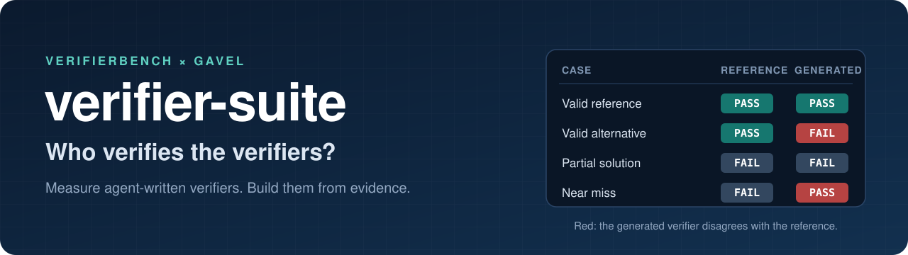
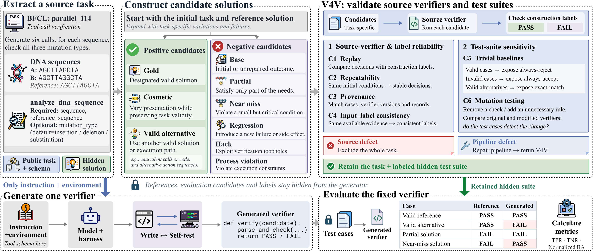

<div align="center">



### Fair verdicts for agent work

[📄 **Paper**](https://arxiv.org/abs/2610.28679) &nbsp;·&nbsp;
[🌐 **Project page**](https://verifierbench.github.io/) &nbsp;·&nbsp;
[🤗 **Dataset**](https://huggingface.co/datasets/Catherine1213/VerifierBench) &nbsp;·&nbsp;
[🛠️ **Gavel**](gavel/) &nbsp;·&nbsp;
[📊 **Results**](#-results-on-verifierbench) &nbsp;·&nbsp;
[🚀 **Quick start**](#-quick-start)

[](https://arxiv.org/abs/2610.28679)
[](https://huggingface.co/datasets/Catherine1213/VerifierBench)
[](gavel/pyproject.toml)
[](LICENSE)

**English** | [中文](README_zh.md)

</div>

---

## 🔥 News

- **[Oct 2026]** 📊 **GPT-6-astra + Gavel reaches 68.3 BA_norm on VerifierBench**, first among all configurations, above every harness in the paper. [Results](#-results-on-verifierbench)
- **[Oct 2026]** 🧪 **One-click suite**: reproduce Gavel on VerifierBench with one command, no root required. [Guide](verifierbench/REPRODUCE.md)
- **[Oct 2026]** 🛠️ The **Gavel** harness is released in this repository: one command to generate, write back and validate verifiers for Harbor tasks.
- **[Oct 2026]** 📄 **VerifierBench** is out: [paper](https://arxiv.org/abs/2610.28679), [dataset](https://huggingface.co/datasets/Catherine1213/VerifierBench) and [project page](https://verifierbench.github.io/).

## 💡 TL;DR

Self-improving agents now produce their own tasks, their own solutions, **and the verifiers that reward them**. If a verifier is wrong, every reward and every training example it touches is wrong too.

- **VerifierBench** measures how good agent-written verifiers really are. The answer: they are far too strict. They reject valid work much more often than they let bad work through.
- **Gavel** is a harness that builds verifiers from the evidence they can actually see, so they check what the task asks for and nothing more.

<div align="center">
<table>
  <tr>
    <td align="center" width="25%"><h3>222</h3>tasks from 6 agent benchmarks</td>
    <td align="center" width="25%"><h3>4,993</h3>hidden test cases, incl. 798 attacks</td>
    <td align="center" width="25%"><h3>36</h3>model × harness configurations</td>
    <td align="center" width="25%"><h3>68.3 / 100</h3>#1 on VerifierBench:<br>GPT-6-astra + Gavel</td>
  </tr>
</table>
</div>

## 🔍 VerifierBench

<p align="center">
  
</p>

VerifierBench gives an agent exactly what a solver would get, the task instruction and its environment, and asks for one executable verifier. That verifier is then run on hidden test cases it has never seen.

- 🧩 **222 tasks** from BFCL v4, ACEBench, τ²-bench, AppWorld, AgentDojo and SWE-bench Verified, covering tool calls, environment state and code changes.
- 🧪 **4,993 hidden test cases**: reference solutions, 1,344 valid variants, 2,629 ordinary mistakes and 798 attacks that exploit gaps or fake success.
- 🛡️ **V4V (Verifier4Verifier)**: replay, repeatability, provenance, input–label consistency, trivial baselines and mutation testing screen every source verifier and test suite before a single label is trusted.
- 🤖 **36 configurations**: 19 models in one common harness, plus Claude Code, Codex, Gemini CLI, OpenClaw and mini-swe-agent.

## 🛠️ Gavel: verifiers built from evidence

If the harness around a model can move the score by more than 20 points, the harness deserves to be designed on purpose. **Gavel** is a verifier-generation harness for [Harbor](https://github.com/harbor-framework/harbor) tasks: one command generates a closed-book verifier for each task, writes it back as `tests/`, and validates it. On VerifierBench, GPT-6-astra scores **68.3 with Gavel**, versus 62.1 with Pi and 58.0 with Codex, and ranks first among all configurations ([results](#-results-on-verifierbench)).

<table>
  <tr>
    <td width="50%" valign="top"><b>🔎 Evidence first</b><br>Before writing a single check, the agent learns exactly what the verifier will see when it judges: the final state, the starting snapshot, the conversation. It checks only what that evidence can witness, and skips what it cannot instead of guessing.</td>
    <td width="50%" valign="top"><b>🎯 Nothing extra</b><br>Nine core rules for every verifier: judge the outcome, not the implementation; use the weakest comparison that still separates right from wrong; never reject a correct solution over wording, order or format. A library of 19,603 sourced domain rules covers what tasks leave implicit.</td>
  </tr>
  <tr>
    <td width="50%" valign="top"><b>✅ Proven to run</b><br>After generation, the harness probes the verifier. If it crashes, or passes the untouched starting state, the agent gets the diagnostic and one chance to fix it.</td>
    <td width="50%" valign="top"><b>⚖️ Honest verdicts</b><br>Every verdict is PASS, FAIL or NO_VERDICT. A broken run is never counted as a failed requirement.</td>
  </tr>
</table>

### ⚔️ Gavel in action

Same task, same agent (OpenCode), same model (GLM-5.2). The only difference is Gavel.

**The task:** Bob, with a credit score of 540, wants a credit card with a foreign transaction fee of at most 1.5%, a minimum payment of at most 1.5%, and virtual card management. The card that fits is the EcoCard, and the correct solution ends with Bob applying for it.

<table>
  <tr>
    <th width="50%">❌ Without Gavel</th>
    <th width="50%">✅ With Gavel</th>
  </tr>
  <tr>
    <td valign="top">

```python
if not used_kb_search:
    return False
if not communicated:
    return False
if db_before != db_after:
    return False
return True
```

Demands that **nothing in the database changes**, a condition the task never states. It rejects Bob's valid EcoCard application, and the empty conversation too: it rejects everything.

</td>
    <td valign="top">

```python
for app_id in new_ids:
    ...
    name_ok = ("nakamoto" in name) or ("bob" in name)
    card_ok = "eco" in card_type
    status_ok = status in ("APPROVED", "PENDING")
    if name_ok and card_ok and status_ok:
        return True
return False
```

Works out from the bank's knowledge base that the EcoCard is the card that fits, then checks the end state for a **new EcoCard application by Bob**, in either status. Accepts the valid solution and rejects the empty one.

</td>
  </tr>
</table>

<sub>Excerpts of the generated verifiers for τ²-bench banking task 006, from the Gavel development experiments.</sub>

### 📊 Results on VerifierBench

| Model | Harness | BA_norm ↑ | TPR ↑ | TNR ↑ | FPR_h ↓ |
|---|---|---:|---:|---:|---:|
| **GPT-6-astra** | **Gavel** | **68.3** | **84.1** | 84.2 | 18.2 |
| Claude Opus 4.8 | Claude Code | 66.2 | 75.8 | 90.4 | 7.8 |
| GPT-6-astra | Pi | 62.1 | 67.4 | 94.6 | 7.4 |
| GPT-6-astra | Codex | 58.0 | 66.2 | 91.8 | 9.2 |
| Claude Opus 4.8 | Pi | 54.0 | 67.7 | 86.3 | 13.5 |
| Kimi K3 | Pi | 53.4 | 70.2 | 83.2 | 13.4 |
| GPT-5.6-sol | Pi | 52.9 | 56.8 | 96.0 | **0.8** |
| GPT-5.6-terra | Pi | 52.9 | 56.5 | **96.3** | 3.6 |
| Gemini 3.5 Flash | Gemini CLI | 50.7 | 59.2 | 91.5 | 7.7 |
| GLM-5.2 | Pi | 48.8 | 68.1 | 80.8 | 12.1 |
| Doubao Seed 2.1 Pro | Pi | 46.8 | 57.0 | 89.9 | 11.4 |
| GPT-5.5 | Pi | 46.6 | 61.6 | 85.1 | 9.9 |
| DeepSeek V4 Pro | Pi | 44.8 | 65.5 | 79.2 | 10.1 |
| DeepSeek V4 Flash | Pi | 40.5 | 60.7 | 79.8 | 8.0 |
| Qwen3.7 Plus | Pi | 40.2 | 57.6 | 82.6 | 13.6 |
| Gemini 3.5 Flash | Pi | 35.7 | 52.4 | 83.3 | 13.2 |
| Kimi K2.6 | Pi | 35.2 | 52.5 | 82.7 | 4.6 |
| GPT-5.6-terra | Codex | 31.0 | 39.2 | 91.8 | 4.7 |
| GPT-5.5 | Codex | 30.3 | 41.2 | 89.1 | 6.2 |
| Doubao Seed 2.0 Code | Pi | 29.7 | 45.0 | 84.8 | 12.3 |
| Doubao Seed 2.0 Lite | Pi | 26.8 | 41.1 | 85.7 | 10.5 |
| GPT-5.6-sol | Codex | 26.2 | 32.3 | 93.9 | 1.0 |
| Doubao Seed 2.0 Pro | Pi | 22.8 | 27.4 | 95.4 | 6.8 |
| GPT-5.1 | Pi | 22.2 | 35.2 | 87.1 | 9.7 |
| Gemini 2.5 Pro | Pi | 14.2 | 31.7 | 82.5 | 4.0 |
| Doubao Seed 2.0 Mini | Pi | 10.6 | 21.1 | 89.5 | 3.7 |
| Gemini 2.5 Pro | Gemini CLI | 5.0 | 23.7 | 81.3 | 3.5 |
| Constant / random | — | 0.0 | — | — | — |

All rows are on the 222 VerifierBench tasks, ranked by BA_norm = TPR + TNR − 100. Rows other than Gavel are from the VerifierBench paper: the 19 Pi-harness configurations of Table 2 and the 7 native-harness configurations of Table 3 (their TPR, TNR and FPR_h from Table 12). Bold marks the best value per column among these rows (lowest for FPR_h).

> [!NOTE]
> For the same model, Gavel raises TPR from 67.4 to 84.1 (+16.7), the weakness VerifierBench found in every model, and trades some rejection strength for it: TNR 84.2 vs 94.6, FPR_h 18.2 vs 7.4.

### 🧪 Reproduce on VerifierBench

One command downloads the frozen VerifierBench data (pinned Hugging Face revision), builds the native environments (τ²-bench, AgentDojo, AppWorld, and 47 SWE images pinned by digest), generates a verifier for every task with Gavel, replays all 4,993 candidates with the original VerifierBench executor, and reports BA_norm, TPR, TNR and FPR_h.

```bash
cd verifierbench/oneclick
export OPENAI_API_KEY=...
./run.sh run --work-dir /path/to/new-workspace \
  --model gpt-6-astra --api-base-url https://api.openai.com/v1 --api-key-env OPENAI_API_KEY
./run.sh status --work-dir /path/to/new-workspace
```

> [!IMPORTANT]
> Needs Linux x86_64, Python ≥ 3.9, Docker Engine 26.x (28 and later do not work), git and bubblewrap, at least 100 GiB free on **both** the workspace disk and Docker's data root, and access to Hugging Face, PyPI, GitHub, npm and Docker Hub. No root or sudo. Use `--api-protocol chat_completions` for endpoints without the Responses API. Full guide: [verifierbench/REPRODUCE.md](verifierbench/REPRODUCE.md).

### 🚀 Quick start

Gavel needs Linux, Python 3.12+, and Docker with Compose 2.24.4 or later.

```bash
cd gavel
pip install -e .

export OPENAI_API_KEY=...
gavel-harness doctor --model openai/gpt-6-astra \
  --base-url https://api.openai.com/v1 --api-key-env OPENAI_API_KEY
gavel-harness gen examples/hello-terminal --model openai/gpt-6-astra \
  --base-url https://api.openai.com/v1 --api-key-env OPENAI_API_KEY \
  --validate --out ./out/r1
```

> [!TIP]
> Any OpenAI-compatible chat endpoint works; for another provider, change `--model` and `--base-url`. The key is read from the environment variable you name and is never written to any output. The current release supports terminal-state and deliverable tasks with the OpenCode executor; see [gavel/README.md](gavel/README.md) and [gavel/docs](gavel/docs/) for paradigms, profiles and the run directory.

## 📁 What's inside

| Path | Contents |
|---|---|
| [`verifierbench/`](verifierbench/) | The VerifierBench paper ([arXiv](https://arxiv.org/abs/2610.28679), [PDF](verifierbench/VerifierBench.pdf)) and abstract |
| [`verifierbench/oneclick/`](verifierbench/oneclick/) | One-click suite: Gavel on VerifierBench, scored with the original executor |
| [`verifierbench/REPRODUCE.md`](verifierbench/REPRODUCE.md) | How to run the suite, what it checks, how results are scored |
| [`gavel/`](gavel/) | The Gavel harness: source, examples and docs |
| [`assets/`](assets/) | Figures used in this README |

## ✍️ Citation

If you find this work useful, please cite:

```bibtex
@article{yin2026verifierbench,
  title   = {VerifierBench: Benchmarking the Generation of Executable Verifiers for LLM Agents},
  author  = {Yin, Jianing and Chen, Ziyi and Wang, Hao and Sun, Yiyou and Jin, Zijian and Song, Dawn and Zhang, Daoan},
  journal = {arXiv preprint arXiv:2610.28679},
  year    = {2026},
  url     = {https://arxiv.org/abs/2610.28679}
}
```

## 📜 License

This repository is released under the [Apache License 2.0](LICENSE). Third-party material keeps its own license and is listed in [`gavel/NOTICE`](gavel/NOTICE) and [`verifierbench/oneclick/NOTICE.md`](verifierbench/oneclick/NOTICE.md).
